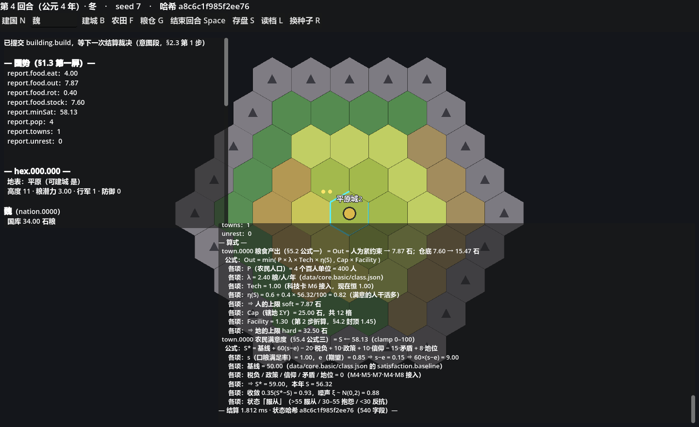

# 群邦纪元（HexaCiv）

《群邦纪元》是一款运行在六角格上的聚合型文明模拟。玩家通过政令影响文明演化，模拟以年度回合和可追溯的因果链推进。

## 快速运行

需要 .NET 8 SDK。在仓库根目录运行：

```sh
dotnet run --project src/HexaCiv.Cli -- run --seed 7 --turns 12 --steps --explain
```

Godot 窗口版使用 Godot .NET 4.7.2。三台开发机的工具探测、安装差异和复核步骤见[开发环境说明](docs/DEV_ENVIRONMENTS.md)。



## 当前进度

M1 Core 与 M2 地图已完成：无头模拟器和 Godot 窗口壳可运行，现有模拟包含 32×20 地图（九类地表、河网水体、十二形胜、五种门槛资源、5 个图层）、建城、农业生产与人口等基础循环。CI 工作流已配置，尚待首次远端双系统全绿；价格、完整阶级、军事、外交等后续系统还未实现。里程碑状态见[路线图](docs/ROADMAP.md)。

## 项目文档

- [开发与 AI 协作约定](AGENTS.md)
- [开发宿主与快速启动](docs/DEV_ENVIRONMENTS.md)
- [UI 设计方案](docs/UI_DESIGN.md)
- [设计文档 GDD](docs/GDD.md)
- [用户需求](docs/REQUIREMENTS.md)
- [路线图](docs/ROADMAP.md)
- [交接记录与验证基线](docs/AI_HANDOFF.md)
